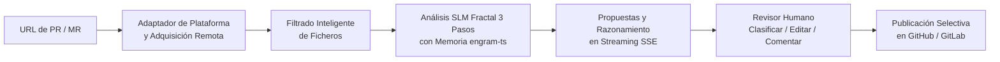
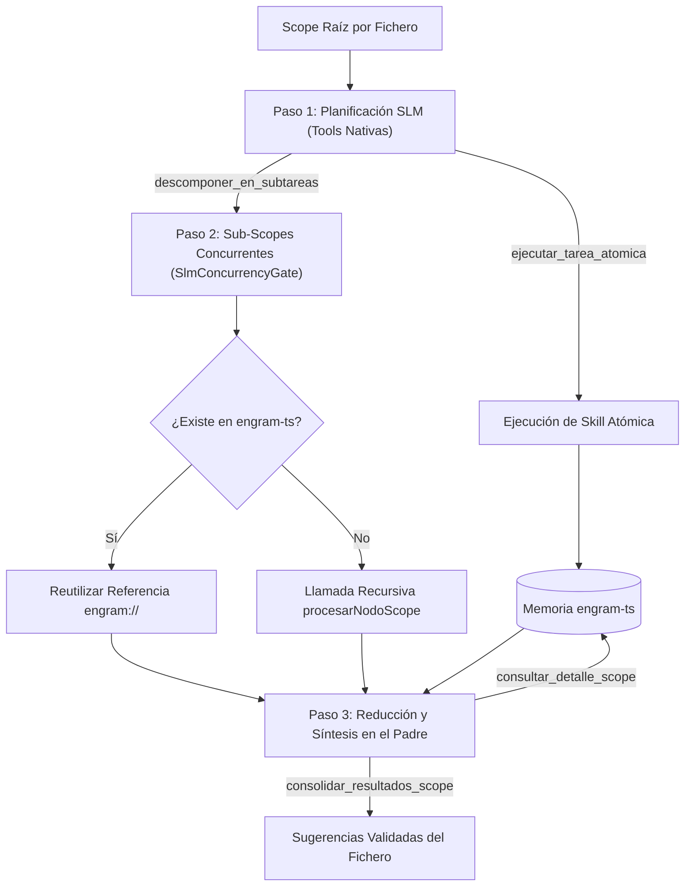

[English](README.md) | **Español**

# CodeReview AI

CodeReview AI es una aplicación web (SPA/PWA) para realizar revisiones colaborativas de código asistidas por modelos de lenguaje pequeños (SLMs) ejecutados exclusivamente en el equipo local.

La aplicación facilita la revisión de Pull Requests de GitHub y Merge Requests de GitLab —tanto en plataformas públicas como en entornos corporativos on-premise— combinando el análisis fractal por alcances (*scopes*) y memoria jerárquica con el criterio, la decisión y el control absoluto de los revisores humanos.

---

## ¿Qué beneficios aporta?

- **Detección temprana de riesgos**: Identifica problemas de diseño orientados a principios SOLID, defectos de calidad/mantenibilidad de código y vulnerabilidades de seguridad antes de integrar los cambios.
- **Privacidad y soberanía de datos**: El código fuente analizado nunca sale del equipo local; la inferencia se realiza mediante un runtime SLM local en `localhost`.
- **Análisis fractal eficiente en contexto**: Divide ficheros complejos en sub-scopes aislados y concurrentes respaldados por la memoria jerárquica de [`engram-ts`](https://github.com/Mordaft/engram-ts), evitando que la ventana de contexto de los modelos locales pequeños se sature.
- **Intervención y control humano (*Human-in-the-loop*)**: Los comentarios generados por el SLM son propuestas sugeridas, nunca decisiones automáticas ni aprobaciones desatendidas.
- **Revisión granular línea a línea**: Cada propuesta se vincula a un fichero y a un número de línea concreto, permitiendo clasificar (`Deseable`, `Importante`, `Bloqueante`), editar, publicar o descartar cada observación de forma individual, así como añadir comentarios manuales en cualquier línea.
- **Streaming en tiempo real**: Invocación progresiva al SLM que extrae y visualiza propuestas a medida que se generan, aislando el razonamiento previo (*thinking process*).
- **Persistencia local completa y PWA auto-actualizable**: Guarda el expediente de revisión en el navegador (IndexedDB) e incorpora un Service Worker offline con sellado de versión en compilación, verificación proactiva de nuevas versiones (al recuperar el foco, cambiar de pestaña y cada 15 minutos) y actualización automática en caliente.
- **Soporte multientorno y bilingüe**: Compatible con GitHub.com, GitHub Enterprise Server, GitLab.com y despliegues GitLab auto-alojados (self-hosted), con interfaz reactiva en **Español / Inglés** y tema claro/oscuro.

---

## Características Principales

### 1. Orquestación Fractal Homogénea de 3 Pasos y Memoria Jerárquica (`engram-ts`)
Para evitar que los modelos locales pequeños agoten su ventana de contexto o pierdan precisión al analizar ficheros extensos, cada archivo se procesa mediante un bucle recursivo homogéneo de 3 pasos (`procesarNodoScope`) impulsado por [`engram-ts`](https://github.com/Mordaft/engram-ts):

- **Paso 1 — Planificación y Decisión (Function Calling Nativo)**:
  - Cada scope arranca con un contexto limpio (`0` tokens heredados del historial de chat del padre), recibiendo únicamente su fragmento de código acotado, el catálogo de *skills* especializadas (`skill_solid`, `skill_security`, `skill_maintainability`, `skill_general`) y las cabeceras ligeras indexadas en `engram-ts`.
  - Mediante Function Calling nativo compatible con OpenAI (`tools` con `tool_choice: 'required' | 'auto' | 'none'` de tipo string), el SLM decide si ejecuta directamente una tarea atómica (`ejecutar_tarea_atomica`) o si divide el trabajo en subtareas más simples (`descomponer_en_subtareas`).
- **Paso 2 — Despliegue Concurrente, Reutilización de Memoria y Prevención de Interbloqueos**:
  - Los sub-scopes hijos se ejecutan en contextos aislados (`ReviewScopeStorage`) acotados por una profundidad máxima configurable (`maxDepth`) y regulados por un semáforo global FIFO de peticiones HTTP (`SlmConcurrencyGate` / `maxConcurrency`) que solo retiene un slot durante llamadas HTTP activas.
  - **Reutilización automática desde memoria**: Antes de invocar al SLM, cada sub-scope consulta `engram-ts` (`findReusableScopeResult`). Si una tarea equivalente (mismo fichero, rango de líneas, *skill*, firma de descripción y hash de código) ya fue resuelta en otra rama, su resultado (`engram://storage/v1/<id>`) se recupera instantáneamente sin realizar llamadas adicionales al modelo.
  - **Salvaguardas para modelos pequeños**: Incluye seguimiento de ancestros (`ancestorScopeIds`) para impedir interbloqueos padre-hijo en promesas `inFlight`, deduplicación automática de subtareas idénticas y colapso a ejecución atómica cuando una descomposición genera un único hijo con el rango completo del padre.
- **Paso 3 — Reducción, Agregación y Divulgación Progresiva**:
  - El nodo padre nunca recibe el texto crudo de los sub-scopes hijos; opera únicamente con sumarios ejecutivos compactos y referencias `engram://` para consolidar los hallazgos (`consolidar_resultados_scope`).
  - Si durante la reducción el nodo padre necesita inspeccionar el detalle completo de un sub-scope hijo, invoca la herramienta `consultar_detalle_scope(id_scope, pregunta)` para recuperar bajo demanda el engrama completo desde `engram-ts`.

### 2. Invocación SLM mediante Streaming y Gestión de Razonamiento
- **Streaming SSE (Server-Sent Events)**: Conexión mediante `/chat/completions` con `stream: true`, control de inactividad por chunk y liberación garantizada de lectores de stream.
- **Aislamiento de razonamiento (*Reasoning / Thinking*)**: En modelos como DeepSeek-R1, Gemma 4, QwQ o Qwen, el cliente separa automáticamente el flujo de razonamiento (`reasoning_content` o bloques `<think>...</think>`) de las llamadas a herramientas y respuestas estructuradas, aplicando *throttling* a las actualizaciones del DOM para mantener la fluidez de la interfaz durante sesiones paralelas.
- **Extracción incremental de propuestas**: A medida que los objetos de sugerencia `{ "id": ..., "line": ... }` se completan dentro de los argumentos en streaming, se validan y se renderizan en vivo sin esperar a que termine el análisis del fichero completo.
- **Resiliencia ante límites de tokens (`finish_reason: "length"`)**: Si el modelo agota su presupuesto de tokens (`maxTokens`), el sistema recupera de forma tolerante todas las propuestas completadas previamente al truncamiento.

### 3. Orquestación del Flujo con LangGraph y Cancelación en Vivo
- **Grafo de estados formal**: Orquestación construida sobre `@langchain/langgraph` con persistencia de hilos (`thread_id`) y gestión de memoria mediante `MemorySaver`.
- **Fases del proceso**:
  1. `acquireReviewData`: Descarga y estructuración de ficheros remotos (incluyendo la descarga y decodificación del contenido íntegro del archivo en el repositorio), parches diff y comentarios remotos existentes.
  2. `analyzeWithLocalSlm`: Ejecuta el análisis fractal por scopes con una instancia aislada de memoria por revisión (`createReviewEngram`) y registra métricas de rendimiento (tiempo de procesamiento, número de ficheros procesados y modelo utilizado).
  3. `waitForHumanReview`: Pausa deliberada del grafo para la toma de decisiones por parte del revisor humano (clasificar, editar, comentar manualmente, aprobar y publicar, o cerrar).
- **Cancelación inmediata**: Cualquier análisis en curso puede detenerse al instante mediante `AbortController` (`cancelReviewWorkflow`), liberando limpiamente las conexiones activas.

### 4. Adaptadores Multiplataforma de URL (GitHub y GitLab)
- **Arquitectura de adaptadores dedicada**: `GitHubAdapter` y `GitLabAdapter` transforman automáticamente URLs web estándar (`/pull/`, `/pulls/`, `/files`, `/-/merge_requests/`, `/diffs`), subgrupos anidados de GitLab y URLs directas de API v3/v4 tanto en entornos cloud como auto-alojados (*on-premise*).
- **Previsualización reactiva de endpoints**: El diálogo de «Nueva revisión» detecta en tiempo real la plataforma, el repositorio, el identificador del cambio y el endpoint de API adaptado mientras el usuario escribe la URL.

### 5. Filtrado Inteligente del Alcance de Revisión (*Review Scope*)
- **Detección de contenido relevante**: Selección automática de ficheros de código fuente y configuración analizables.
- **Exclusión automática**: Omite ficheros binarios, imágenes, lockfiles de dependencias (`package-lock.json`, `pnpm-lock.yaml`, `yarn.lock`), bundles minificados y assets estáticos, optimizando el contexto y la velocidad del análisis.

### 6. Persistencia Local con Dexie.js e IndexedDB
- **Almacenamiento transaccional**: Guarda en IndexedDB el expediente íntegro de la revisión: metadatos de la PR/MR, snapshots completos de ficheros, parches unificados, propuestas del SLM, comentarios humanos y métricas de ejecución.
- **Ciclo de vida y clasificación de propuestas**: Registro del estado (`pending`, `published`) y de la prioridad asignada por el revisor (`Deseable`, `Importante`, `Bloqueante`).
- **Privacidad estricta**: Los tokens personales de acceso no se almacenan en disco ni en IndexedDB; residen únicamente en la memoria activa de la sesión.

### 7. Visor de Diferencias e Interfaz de Revisión Interactiva
- **Navegación contextual**: Árbol de ficheros con indicación de estado (añadido, modificado, eliminado) y contador de propuestas por fichero.
- **Comentarios manuales e inline**: Permite hacer clic en cualquier línea del código o diff para abrir un editor integrado y añadir observaciones manuales del revisor junto a las propuestas de la IA.
- **Categorías y severidades**:
  - **Categorías**: Principios SOLID (`solid`), Seguridad (`security`) y Calidad/Mantenibilidad (`maintainability`).
  - **Severidades**: `alta`, `media` y `baja`.
- **Acciones directas por propuesta**:
  - **Clasificar**: Asignar prioridad `Deseable`, `Importante` o `Bloqueante`.
  - **Editar**: Ajustar el mensaje y la recomendación sugerida por el SLM antes de su publicación.
  - **Eliminar**: Descartar la propuesta localmente.
  - **Aprobar y publicar**: Envía los comentarios pendientes a la API remota de GitHub o GitLab al confirmar la revisión.

### 8. Historial Analítico y Mapa de Calor (*Heatmap*) Responsivo
- **Distribución por plataforma**: Gráfico circular (*donut chart*) con el desglose porcentual de revisiones entre GitHub y GitLab.
- **Mapa de actividad responsivo**: Calendario SVG estilo contribuciones que calcula y adapta dinámicamente el rango de meses visibles (entre 4 y 10 meses) según el ancho disponible de la pantalla.
- **Tabla de auditoría histórica**: Listado detallado de todas las revisiones con repositorio, proveedor, estado, fecha, ficheros procesados, sugerencias generadas, duración total del análisis y modelo SLM empleado.

### 9. PWA Offline, Verificación de Versión y Actualización Automática
- **Sellado automático de versión en compilación (`pwaVersionPlugin`)**: En cada build de producción (`vite.config.ts`), se inyecta automáticamente un timestamp único en `SW_VERSION` dentro de `dist/sw.js` (`codereview-shell-<version>`), garantizando la invalidación determinista de cachés antiguas en cada despliegue.
- **Registro sin caché intermedia (`updateViaCache: 'none'`)**: El Service Worker se registra evitando las cachés HTTP del navegador o CDN (como los 10 minutos de caché de GitHub Pages) para consultar siempre el `sw.js` más reciente disponible en el servidor.
- **Verificación proactiva y automática de nuevas versiones (`initPwaUpdate`)**:
  - Comprueba actualizaciones al iniciar la aplicación (`registration.waiting` y eventos `updatefound`).
  - Ejecuta `registration.update()` automáticamente cada vez que la ventana recupera el foco (`focus`), cuando la pestaña vuelve a estar visible (`visibilitychange`) y de forma periódica cada **15 minutos** en segundo plano.
  - Incluye además un botón manual de **«Comprobar actualizaciones»** (`checkForUpdates`) en la pantalla de **Configuración**.
- **Activación transparente y recarga automática**:
  - Al detectar una nueva versión, muestra un aviso interactivo (`#pwa-update-toast`). Al confirmar la actualización (o activarse el nuevo worker), envía el mensaje `SKIP_WAITING`, purga las cachés de versiones anteriores (`codereview-shell-*`) durante el evento `activate` (`clients.claim()`) y recarga automáticamente la aplicación mediante el evento `controllerchange`.
  - En entorno de desarrollo (`import.meta.env.DEV`), desregistra automáticamente cualquier Service Worker previo para evitar conflictos con el HMR de Vite.
- **Estrategia híbrida y selectiva de caché (`public/sw.js`)**:
  - **Network-First con fallback a caché** para peticiones de navegación HTML (`index.html`).
  - **Cache-First** para recursos estáticos inmutables (bundles de Vite, hojas de estilo, iconos SVG y fuentes de Google Fonts).
  - **Exclusión estricta de APIs y credenciales (`isStaticRequest`)**: Nunca almacena en caché llamadas a las APIs de GitHub o GitLab, endpoints de inferencia SLM (`/v1/`, `/v4/`, `/graphql`), peticiones con cabecera `Authorization` ni métodos distintos de `GET`.

### 10. Internacionalización (i18n), Temas y Diagnóstico Local
- **Interfaz bilingüe (i18n) y temas**: Cambio instantáneo entre **Español** e **Inglés** (con paridad 1:1 verificada en todas las claves) y soporte persistente para modo claro y oscuro.
- **Sistema de diagnóstico y telemetría local**: Trazabilidad estructurada en tiempo real (`trace`) con tiempos de respuesta HTTP, planes de descomposición de scopes, aciertos de caché en `engram-ts`, proporción de caracteres de razonamiento vs. contenido y motivos de finalización del stream.

---

## ¿Cómo funciona el flujo de revisión?





1. **Entrada de URL**: Se introduce la URL de la Pull Request (GitHub) o Merge Request (GitLab) con validación y adaptación en vivo.
2. **Autenticación efímera**: Se introduce el token personal (PAT) en memoria de sesión si el repositorio es privado o si se publicarán comentarios.
3. **Adquisición**: La aplicación descarga metadatos, el contenido completo de los ficheros, parches diff y comentarios remotos previos.
4. **Análisis SLM fractal**: El runtime local procesa cada fichero mediante el orquestador recursivo de 3 pasos y `engram-ts`, emitiendo el razonamiento en vivo y categorizando hallazgos en SOLID, seguridad y mantenibilidad.
5. **Revisión humana**: El usuario inspecciona el código, evalúa las propuestas de la IA, añade comentarios manuales por línea y clasifica o edita cada observación.
6. **Publicación controlada**: Al aprobar la revisión, los comentarios pendientes se publican en el hilo remoto identificando claramente su contexto y severidad.

> **Importante**: La aplicación nunca aprueba, cierra ni fusiona automáticamente Pull Requests o Merge Requests en la plataforma remota.

---

## Requisitos

- **Navegador**: Cualquier navegador moderno con soporte para ES Modules, IndexedDB y Web Streams API (Chrome, Edge, Firefox, Safari).
- **Runtime SLM local**: Un servicio compatible con la API de OpenAI y soporte para Function Calling nativo (`tools`) accesible en `localhost`, por ejemplo:
  - [LM Studio](https://lmstudio.ai/)
  - [Ollama](https://ollama.com/)
  - [llama.cpp](https://github.com/ggml-org/llama.cpp)
  - [vLLM](https://github.com/vllm-project/vllm)
- **Credenciales Git**: Token de acceso personal (PAT) con permisos de lectura y escritura en la plataforma correspondiente (GitHub o GitLab).

---

## Configuración del SLM

Desde la pantalla de **Configuración** de la aplicación se gestionan los siguientes parámetros:

| Parámetro | Descripción | Valor por defecto |
| :--- | :--- | :--- |
| **URL local del runtime** | Endpoint base compatible con OpenAI. | `http://localhost:11434/v1` |
| **Modelo SLM** | Nombre del modelo cargado en el runtime. | `llama3.2` |
| **Temperatura** | Control de determinismo de la inferencia. | `0.2` |
| **Máximo de tokens** | Presupuesto máximo de salida por llamada de scope. | `4096` |
| **Profundidad máxima de scopes (`maxDepth`)** | Límite de niveles recursivos al descomponer un fichero en subtareas (`1`–`5`). | `3` |
| **Sub-scopes paralelos (`maxConcurrency`)** | Número máximo de peticiones HTTP simultáneas al SLM (`1`–`6`). | `2` |
| **Instrucciones de revisión** | Directrices de revisión personalizables (SOLID, seguridad, mantenibilidad). | Predefinidas |
| **Contrato de salida** | Esquema JSON bloqueado de solo lectura para asegurar compatibilidad. | Estricto |

> **Tip**: El botón de refresco (`↻`) junto al selector de modelos consulta el endpoint `/models` del runtime para listar automáticamente los modelos disponibles en tu entorno local.

---

## Privacidad y Seguridad

- **Cero telemetría externa**: Ningún dato de código, diffs ni propuestas se transfiere a proveedores de IA en la nube.
- **Tokens efímeros**: Los tokens de GitHub/GitLab solo viven en la memoria de la sesión activa del navegador; nunca se almacenan en `localStorage` ni en `IndexedDB`.
- **Runtimes locales protegidos**: La aplicación valida que la URL del SLM pertenezca estrictamente a `localhost` (`127.0.0.1` o `::1`).
- **Auditoría local**: Toda la información persistida puede consultarse o eliminarse de forma manual e inmediata desde la propia aplicación.

---

## Instalación y Puesta en Marcha

Para ejecutar el proyecto en modo desarrollo local:

1. Clonar el repositorio:
   ```bash
   git clone git@github.com:Mordaft/codereview-ai-assisted.git
   cd codereview-ai-assisted
   ```

2. Instalar dependencias:
   ```bash
   pnpm install
   ```

3. Iniciar el servidor de desarrollo:
   ```bash
   pnpm run dev
   ```

4. Ejecutar la suite de pruebas automatizadas (adaptadores de plataforma, paridad i18n, políticas de caché del Service Worker, heatmap de historial, parser SLM en streaming y orquestación fractal con `engram-ts`):
   ```bash
   pnpm test
   ```

5. Compilar para producción:
   ```bash
   pnpm run build
   ```

---

## Estado del Proyecto

La aplicación se encuentra en desarrollo activo y lista para flujos locales de revisión asistida por IA. Incluye adaptadores multiplataforma para GitHub y GitLab, persistencia transaccional en IndexedDB, orquestación con LangGraph, análisis fractal de 3 pasos con memoria jerárquica [`engram-ts`](https://github.com/Mordaft/engram-ts) y Function Calling nativo, streaming SSE con aislamiento de razonamiento, espacio de trabajo interactivo línea a línea, historial analítico con mapa de calor responsivo, internacionalización completa (Español/Inglés) y soporte PWA offline.
