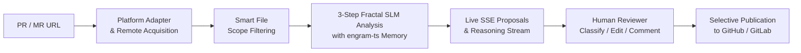
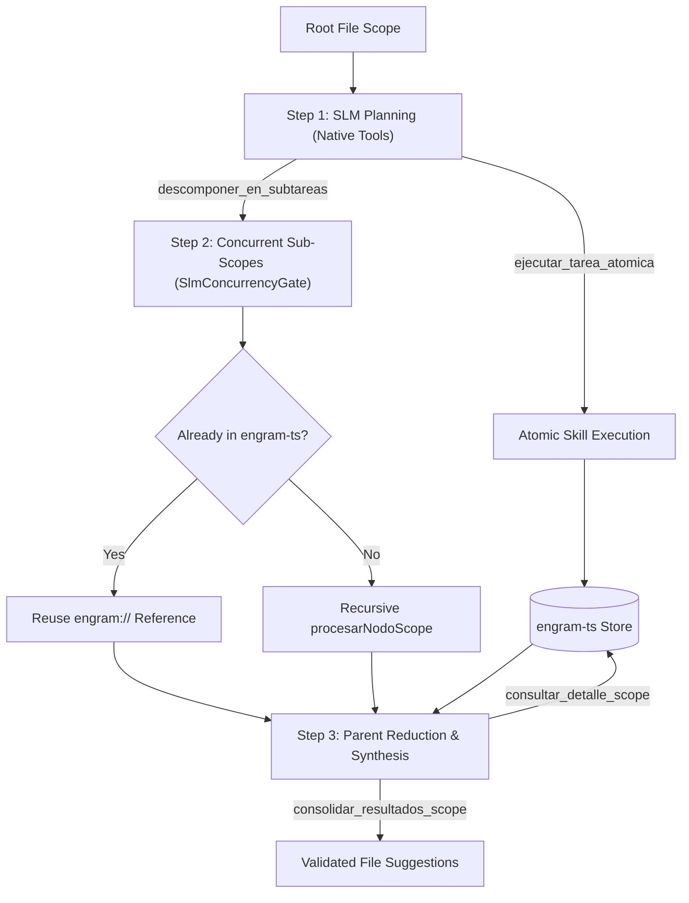

**English** | [Español](README.es.md)

# CodeReview AI

CodeReview AI is a web application (SPA/PWA) for collaborative code reviews assisted by Small Language Models (SLMs) running exclusively on your local machine.

The application streamlines reviewing GitHub Pull Requests and GitLab Merge Requests — across both public hosting platforms and on-premise enterprise environments — combining fractal scope-based AI analysis and hierarchical memory with the judgment, decision-making, and full control of human reviewers.

---

## Key Benefits

- **Early Risk Detection**: Identifies architectural design issues against SOLID principles, code quality/maintainability flaws, and security vulnerabilities before changes are merged.
- **Data Privacy & Sovereignty**: Analyzed source code never leaves your local workstation; inference runs via a local SLM runtime hosted on `localhost`.
- **Context-Efficient Fractal Analysis**: Breaks down complex files into isolated, concurrent sub-scopes powered by [`engram-ts`](https://github.com/Mordaft/engram-ts) hierarchical memory, preventing context window saturation on small local models.
- **Human-in-the-Loop Control**: Suggestions generated by the SLM are presented as advisory proposals, never as automated decisions or unattended approvals.
- **Granular Line-by-Line Review**: Each proposal is tied to an exact file and line number, allowing you to classify (`Desirable`, `Important`, `Blocking`), edit, publish, or discard each observation individually.
- **Real-Time Streaming**: Progressive SLM streaming that extracts and displays proposals live as they are generated, isolating preliminary thinking/reasoning processes.
- **Full Local Persistence & Self-Updating PWA**: Saves the entire review dossier in the browser (IndexedDB) and includes an offline-capable Service Worker with build-time version stamping, proactive version checks (on focus, visibility change, and every 15 minutes), and automatic hot-reload updates.
- **Multi-Environment & Bilingual**: Compatible with GitHub.com, GitHub Enterprise Server, GitLab.com, and self-hosted GitLab deployments, with a reactive **English / Español** interface and Light/Dark modes.

---

## Core Features

### 1. 3-Step Fractal Scope Orchestration & Hierarchical Memory (`engram-ts`)
To prevent local SLMs from exhausting their context window or losing focus on large files, each file is analyzed through a recursive, homogeneous 3-step orchestrator (`procesarNodoScope`) backed by [`engram-ts`](https://github.com/Mordaft/engram-ts):

- **Step 1 — Planning & Decomposition (Native Function Calling)**:
  - Each scope starts with a clean context (`0` tokens inherited from parent chat history), receiving only its specific code slice, the catalog of specialized review skills (`skill_solid`, `skill_security`, `skill_maintainability`, `skill_general`), and lightweight memory headers from `engram-ts`.
  - Using native OpenAI Function Calling (`tools` with string `tool_choice: 'required' | 'auto' | 'none'`), the SLM decides whether to execute an atomic analysis (`ejecutar_tarea_atomica`) or split the scope into focused sub-scopes (`descomponer_en_subtareas`).
- **Step 2 — Concurrent Execution, Memory Reuse & Deadlock Prevention**:
  - Sub-scopes run in isolated `ReviewScopeStorage` contexts up to a configurable recursion depth (`maxDepth`) and are governed by a global FIFO request semaphore (`SlmConcurrencyGate` / `maxConcurrency`) that only holds a slot during active HTTP calls.
  - **Automatic Memory Reuse**: Before invoking the SLM, each sub-scope checks `engram-ts` (`findReusableScopeResult`). If an equivalent scope (matching file, line range, skill, task signature, and code hash) was already resolved in another branch, the result (`engram://storage/v1/<id>`) is reused immediately without firing redundant LLM requests.
  - **Small-Model Safeguards**: Includes ancestor scope tracking (`ancestorScopeIds`) to prevent parent-child `inFlight` self-deadlocks, automatic subtask deduplication, and single-child full-range collapse.
- **Step 3 — Aggregation & Progressive Disclosure**:
  - Parent scopes never ingest raw child transcripts; they receive only compact executive summaries and `engram://` references to consolidate findings (`consolidar_resultados_scope`).
  - If the parent scope requires deeper context on a specific child finding, it can invoke `consultar_detalle_scope(id_scope, pregunta)` to retrieve the full indexed payload from `engram-ts` on demand.

### 2. Streaming SLM Invocation & Reasoning Management
- **SSE Streaming (Server-Sent Events)**: Connected to `/chat/completions` with `stream: true`, per-chunk inactivity timeouts, and automatic stream reader cleanup.
- **Reasoning Isolation (*Thinking Process*)**: When using reasoning models such as DeepSeek-R1, Gemma 4, QwQ, or Qwen, the client separates thought output (`reasoning_content` or `<think>...</think>` tags) from tool calls and structured responses, throttling UI updates to keep the browser responsive during parallel streams.
- **Incremental Proposal Extraction**: As individual suggestion objects `{ "id": ..., "line": ... }` are completed within streamed tool arguments, they are validated and rendered live in the workspace without waiting for the entire file analysis to finish.
- **Resilience Against Token Limits (`finish_reason: "length"`)**: If a model exhausts its token budget (`maxTokens`), the parser recovers all valid proposals completed prior to truncation.

### 3. Workflow Orchestration with LangGraph & Cancellation Control
- **Formal State Graph**: Orchestration built on `@langchain/langgraph` featuring persistent review threads (`thread_id`) and checkpoint memory management with `MemorySaver`.
- **Pipeline Stages**:
  1. `acquireReviewData`: Fetches and structures remote files (including full repository file content decoding), unified diff patches, and existing remote comments.
  2. `analyzeWithLocalSlm`: Runs the fractal `engram-ts` scope analysis across candidate files with an isolated per-review memory store (`createReviewEngram`) and records processing metrics (elapsed time, processed files count, model).
  3. `waitForHumanReview`: Pauses execution for human reviewer intervention (classify, edit, add manual comments, approve & publish, or close).
- **Instant Cancellation**: In-progress analyses can be aborted at any time via `AbortController` (`cancelReviewWorkflow`), cleanly releasing active HTTP streams.

### 4. Multi-Platform URL Adapters (GitHub & GitLab)
- **Unified Adapter Architecture**: Dedicated `GitHubAdapter` and `GitLabAdapter` normalize standard web URLs (`/pull/`, `/pulls/`, `/files`, `/-/merge_requests/`, `/diffs`), deeply nested GitLab subgroups, and direct API v3/v4 endpoints across public and self-hosted instances.
- **Live URL Preview**: The "New Review" dialog reactively detects the target platform, repository, PR/MR number, and resolved API endpoint as you type.

### 5. Smart Scope Filtering (*Review Scope*)
- **Relevant Content Detection**: Automatically targets analyzable source code and configuration files.
- **Automatic Exclusion**: Excludes binary files, images, dependency lockfiles (`package-lock.json`, `pnpm-lock.yaml`, `yarn.lock`), minified bundles, and static assets, optimizing context usage and processing speed.

### 6. Local Persistence with Dexie.js & IndexedDB
- **Transactional Storage**: Stores review dossiers locally in IndexedDB: PR/MR metadata, full file snapshots, diff patches, SLM proposals, human comments, and analysis performance metrics.
- **Proposal Lifecycle & Priority Classification**: Tracks lifecycle state (`pending`, `published`) and reviewer classification (`Desirable`, `Important`, `Blocking`) for every observation.
- **Strict Privacy**: Personal access tokens are never persisted to disk or IndexedDB; they remain exclusively in active session memory.

### 7. Interactive Diff Viewer & Review Workspace
- **Contextual File Tree**: Hierarchical navigation with file status badges (added, modified, deleted) and per-file proposal counters.
- **Interactive Line-by-Line Viewer**: Click any line in the source/diff view to open an inline composer and add manual review comments alongside AI proposals.
- **Categories & Severity Levels**:
  - **Categories**: SOLID principles (`solid`), Security (`security`), and Quality/Maintainability (`maintainability`).
  - **Severity Levels**: High (`alta`), Medium (`media`), and Low (`baja`).
- **Direct Proposal Actions**:
  - **Classify**: Mark proposals as `Desirable`, `Important`, or `Blocking`.
  - **Edit**: Adjust the message and suggested recommendation prior to publication.
  - **Delete**: Discard the proposal locally.
  - **Approve & Publish**: Publishes pending comments to the remote GitHub PR or GitLab MR thread when confirming the review.

### 8. Review History & Responsive Activity Heatmap
- **Platform Distribution**: Visual donut chart breaking down total reviews across GitHub and GitLab.
- **Responsive Activity Heatmap**: Contribution-style SVG calendar that dynamically adjusts the displayed window (between 4 and 10 months) based on available viewport width.
- **Audit Table**: Sortable history of all reviews displaying repository, provider, status, timestamp, processed files count, generated suggestions count, total processing duration, and SLM model used.

### 9. PWA Offline Caching, Version Verification & Automatic Updates
- **Build-Time Version Stamping (`pwaVersionPlugin`)**: During each production build (`vite.config.ts`), a unique build timestamp is automatically injected into `SW_VERSION` inside `dist/sw.js` (`codereview-shell-<version>`), ensuring deterministic cache invalidation on every deployment.
- **Cache-Bypass Registration (`updateViaCache: 'none'`)**: Registers the Service Worker bypassing HTTP browser/CDN caches (such as GitHub Pages 10-minute cache headers) so version checks always inspect the latest `sw.js` on the server.
- **Automatic Proactive Version Verification (`initPwaUpdate`)**:
  - Verifies version updates on startup (`registration.waiting` and `updatefound` listeners).
  - Automatically triggers `registration.update()` whenever the browser window regains focus (`focus`), when the tab becomes visible (`visibilitychange`), and periodically every **15 minutes** in the background.
  - Provides an on-demand **"Check for updates"** (`checkForUpdates`) action inside the **Settings** screen.
- **Seamless Activation & Auto-Reload**:
  - When a new version is detected, displays an in-app update banner (`#pwa-update-toast`). Confirming the update dispatches `SKIP_WAITING` to the waiting Service Worker, purges outdated `codereview-shell-*` caches during `activate` (`clients.claim()`), and automatically reloads the application on `controllerchange`.
  - Automatically unregisters Service Workers in local development mode (`import.meta.env.DEV`) to avoid interfering with Vite HMR.
- **Selective Hybrid Caching (`public/sw.js`)**:
  - **Network-First with Cache Fallback** for HTML navigation requests (`index.html`).
  - **Cache-First** for static assets (Vite bundles, CSS, SVGs, and Google Fonts).
  - **Strict API & Auth Exclusion (`isStaticRequest`)**: Never caches GitHub/GitLab API requests, local SLM inference endpoints (`/v1/`, `/v4/`, `/graphql`), requests carrying an `Authorization` header, or non-`GET` methods.

### 10. Internationalization (i18n), Themes & Local Diagnostics
- **Bilingual UI (i18n) & Themes**: Instant switching between **English** and **Español** (with 1:1 translation key parity) and persistent Light/Dark theme support.
- **Local Diagnostics & Telemetry**: Real-time structured console tracing (`trace`) covering HTTP latency, scope decomposition plans, `engram-ts` memory cache hits, reasoning vs. content ratios, and stream completion statuses.

---

## How the Review Workflow Works





1. **Input URL**: Provide the Pull Request (GitHub) or Merge Request (GitLab) URL with live adapter validation.
2. **Ephemeral Authentication**: Provide your Personal Access Token (PAT) in session memory for private repositories or comment publishing.
3. **Acquisition**: The app downloads metadata, full file contents, diff patches, and existing comments.
4. **Fractal SLM Analysis**: The local runtime processes each file through the 3-step `engram-ts` scope orchestrator, streaming reasoning and categorizing findings into SOLID, security, and maintainability issues.
5. **Human Review**: Inspect the code, evaluate AI proposals, add manual line comments, and classify or edit each item.
6. **Controlled Publication**: Pending comments are published to the remote thread when approving the review locally.

> **Important**: The application never automatically approves, closes, or merges Pull Requests or Merge Requests on the remote platform.

---

## Requirements

- **Browser**: Any modern browser supporting ES Modules, IndexedDB, and Web Streams API (Chrome, Edge, Firefox, Safari).
- **Local SLM Runtime**: An OpenAI-compatible API endpoint supporting native Function Calling (`tools`) accessible on `localhost`, such as:
  - [LM Studio](https://lmstudio.ai/)
  - [Ollama](https://ollama.com/)
  - [llama.cpp](https://github.com/ggml-org/llama.cpp)
  - [vLLM](https://github.com/vllm-project/vllm)
- **Git Credentials**: A Personal Access Token (PAT) with read and write permissions on the target platform (GitHub or GitLab).

---

## SLM Configuration

The in-app **Settings** panel allows configuring:

| Parameter | Description | Default Value |
| :--- | :--- | :--- |
| **Local Runtime URL** | Base OpenAI-compatible endpoint URL. | `http://localhost:11434/v1` |
| **SLM Model** | Name of the active model loaded in the runtime. | `llama3.2` |
| **Temperature** | Controls output determinism. | `0.2` |
| **Max Tokens** | Maximum output token budget per scope call. | `4096` |
| **Max Scope Depth (`maxDepth`)** | Maximum recursion depth for fractal task decomposition (`1`–`5`). | `3` |
| **Max Parallel Sub-Scopes (`maxConcurrency`)** | Maximum simultaneous SLM HTTP requests across scopes (`1`–`6`). | `2` |
| **Review Instructions** | Customizable review guidelines (SOLID, security, maintainability). | Preconfigured |
| **Output Contract** | Immutable, read-only JSON schema guaranteeing parser compatibility. | Strict |

> **Tip**: Click the refresh button (`↻`) next to the model selector to query `/models` and auto-discover models loaded in your local runtime.

---

## Privacy & Security

- **Zero External Telemetry**: No source code, diffs, or review proposals are sent to cloud AI providers.
- **Ephemeral Credentials**: GitHub/GitLab tokens only exist in active browser tab memory; they are never saved to `localStorage` or `IndexedDB`.
- **Localhost Validation**: The application strictly validates that the SLM runtime URL targets `localhost` (`127.0.0.1` or `::1`).
- **Local Audit & Erasure**: All persisted review data can be inspected or deleted at any time directly from the application.

---

## Getting Started

To run the project locally in development mode:

1. Clone the repository:
   ```bash
   git clone git@github.com:Mordaft/codereview-ai-assisted.git
   cd codereview-ai-assisted
   ```

2. Install dependencies:
   ```bash
   pnpm install
   ```

3. Start the development server:
   ```bash
   pnpm run dev
   ```

4. Run the automated test suite (Platform adapters, i18n parity, Service Worker cache policy, History heatmap, SLM streaming parser, and `engram-ts` fractal scope orchestration):
   ```bash
   pnpm test
   ```

5. Build for production:
   ```bash
   pnpm run build
   ```

---

## Project Status

The application is actively developed and production-ready for local AI-assisted workflows. Implemented capabilities include multi-platform GitHub/GitLab URL adapters, transactional IndexedDB persistence, LangGraph workflow orchestration, 3-step fractal scope analysis with [`engram-ts`](https://github.com/Mordaft/engram-ts) hierarchical memory and native Function Calling, SSE streaming with reasoning isolation, interactive line-by-line review, historical analytics with responsive heatmaps, full English/Spanish internationalization, and offline-capable PWA support.
